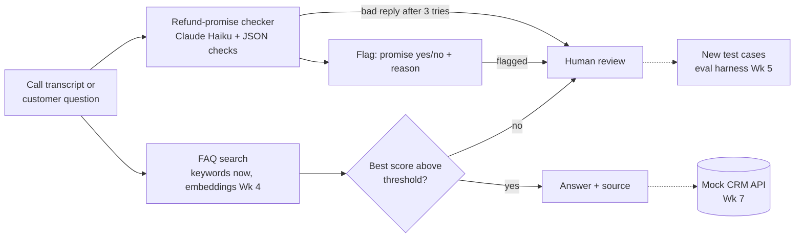

# Call Insights Copilot

An AI copilot that catches costly mistakes in contact-center conversations before they turn into refunds, escalations or compliance breaches, and sends uncertain cases to a human.

> Status: early build. Everything here is built and evaluated on **synthetic data only**. Nothing is deployed in production.

## 1. Problem

Contact-center agents and bots make promises to customers every day. Some of those promises break policy: a refund the policy doesn't allow, a credit with no approval, a missing required disclaimer. Each one can leak money, trigger an escalation or create a compliance risk, and today most are found only after a customer complains or during a small manual QA sample.

**Who feels it:**

| User | Pain |
|---|---|
| Quality / compliance team | Can review only a small sample of conversations by hand |
| Floor manager | Learns about bad promises after the escalation arrives |
| Operations head | Pays for refunds, credits and SLA penalties that should not have happened |

**What the copilot does:** it reads each agent or bot response, flags the ones that break a process or compliance rule, explains why, and sends flagged and uncertain cases to a human for review. Every flagged case becomes a new test case, so the checks get better over time.

**Why both error types matter:**

- **Missed flag (false negative):** a bad promise reaches the customer and money leaks out.
- **False alarm (false positive):** reviewers waste time and stop trusting the flags.

## 2. What's built so far

| Module | What it does | Week |
|---|---|---|
| Refund-promise checker | Flags whether an agent sentence promises a refund, with a reason, using Claude Haiku | 1 |
| Regex baseline | A keyword version of the same check, used to show where rules fail | 1 |
| Structured output with checks | Reads the model's JSON reply, checks types and allowed values, retries up to 3 times, else hands to a human | 2 |
| REST client | Calls an API with a timeout, status-code handling and one error path for all request failures | 2 |
| FAQ search v0 | Keyword search over 5 FAQs with stop words and synonyms; returns the answer with its source, or "no good match" below a threshold | 2 |
| Safe retries demo | Idempotency keys plus exponential backoff, so a retried refund request is paid once | 2 |

**Refund rule used:** a refund promise is any commitment to give money back in any form: cash, card reversal, bill credit or a discount on a charge. Loyalty points do not count.

## 3. Architecture (v0)

Solid arrows are built. Dotted arrows are planned.



**Design choice:** every module has a "not sure" path to a human. A wrong answer given to a customer costs more than a handoff.

## 4. Results so far

| Check | Test set | Precision | Recall |
|---|---|---|---|
| Regex baseline | 11 synthetic sentences | 0.50 | 0.17 |
| Claude Haiku checker | 11 synthetic sentences | 1.00 | 0.83 |

The regex missed most promises because customers and agents say "money back" in many ways. The model did far better, but 11 sentences is too few to trust; the Week 5 golden set grows this to 80 cases, including negation, conditional promises and paraphrases.

## 5. Roadmap

| Week | Adds |
|---|---|
| 3 | Pydantic structured output, one-tool agent, eval v0 on 40 cases, repo goes public after a secrets check |
| 4 | Retrieval with embeddings, recall@k and MRR, compared with the keyword search |
| 5 | 80-case golden set, LLM judge checked against human labels, cost per call, small vs large model |
| 6 | Agent loop with call-history lookup, refund rule enforced in code, handoff to a human |
| 7 | MCP server exposing the checks as tools, mock CRM |
| 8 | PII redaction, red-team tests (prompt injection), cost and quality charts, PRD v1 |
| 9 | Postgres and SQL analytics: repeat-call rate, disclaimer pass rate |
| 10 | FastAPI service, signed webhook, Docker, CI running tests and evals on every push |
| 11 | Cloud deploy, deployment guide |

## How to run

```bash
python3 -m venv .venv && source .venv/bin/activate
pip install anthropic requests
cp .env.example .env   # add your own ANTHROPIC_API_KEY; .env is never committed
```

## Data

All transcripts, FAQs and customers are synthetic. No customer or employer data is used.
